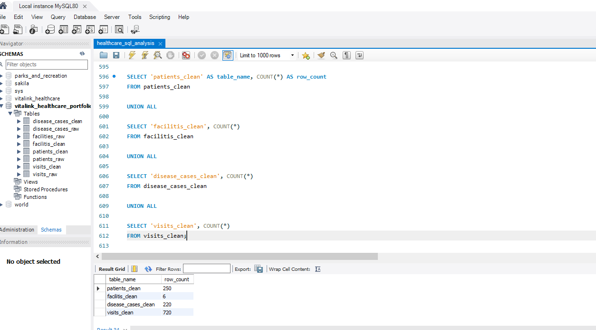
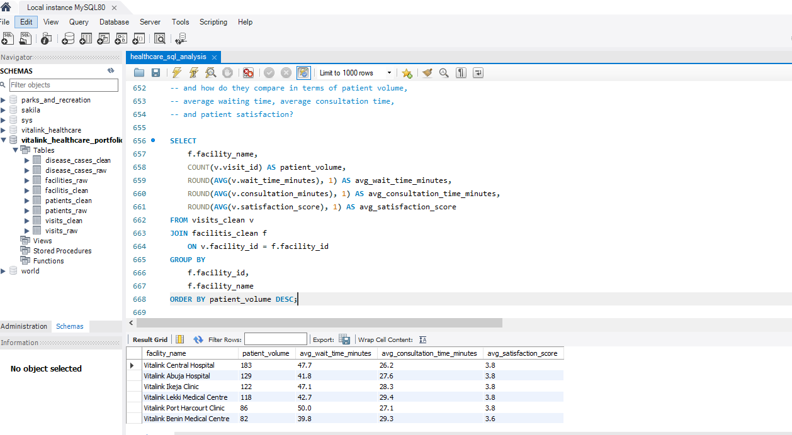
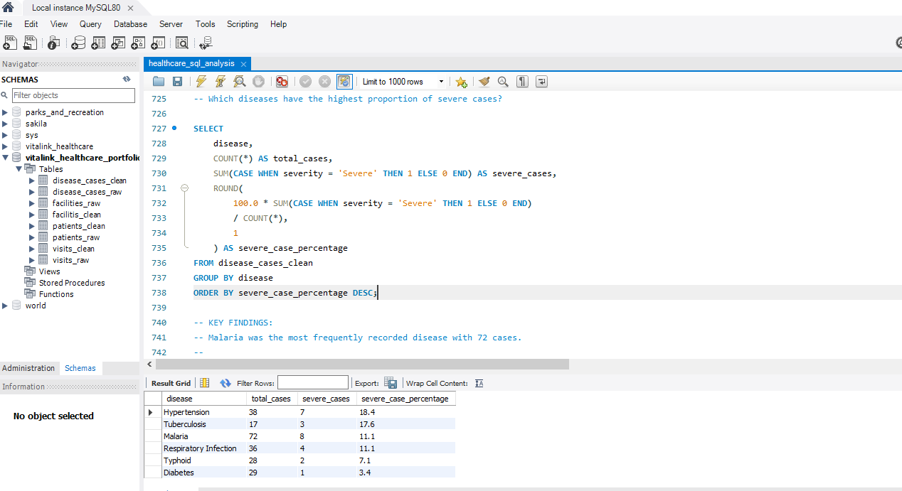
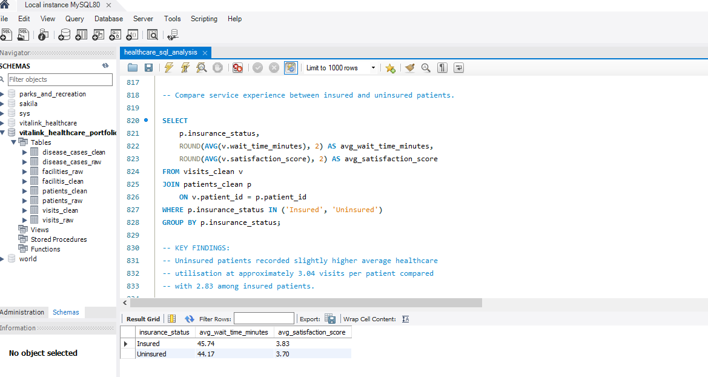

# Healthcare SQL Analysis Portfolio

## Project Overview

This project demonstrates an end-to-end healthcare data analysis workflow using **MySQL**. It covers data validation, data cleaning, database structure, referential integrity, and business analysis using a synthetic healthcare dataset.

The objective was to transform raw healthcare data into a clean, structured dataset and use SQL to answer practical questions related to healthcare facility performance, disease surveillance, and patient access.

> **Disclaimer:** This project uses a completely synthetic dataset created solely for educational and portfolio purposes. No real patient, healthcare facility, employee, or confidential organisational data was used. This project is not affiliated with, sponsored by, or endorsed by any real organisation named Vitalink. Any similarity to real organisations, facilities, individuals, or operational data is coincidental.

## Watch the Project Summary

For a quick overview of the complete SQL project, watch the 3-minute summary video below:

[Watch the Healthcare SQL Analysis Project Summary](https://youtu.be/aEnB5xBdeqc)

The video summarises the full workflow, including data validation, cleaning, database design, and the key business findings.

## Tools Used

- MySQL
- MySQL Workbench
- SQL
- OBS Studio
- Canva

## SQL Script

The complete SQL workflow is available in the repository:

[View the full healthcare SQL analysis script](sql/healthcare_sql_analysis.sql)

The script consolidates the full project workflow demonstrated in the accompanying video walkthroughs, from initial validation and data cleaning through database design and business analysis.

## Dataset

This project uses four fully synthetic healthcare datasets created solely for portfolio and educational purposes:

- [Patients](data/patients.csv)
- [Healthcare Facilities](data/facilities.csv)
- [Patient Visits](data/visits.csv)
- [Disease Cases](data/disease_cases.csv)

The uploaded CSV files represent the original raw source data used in the project. The raw datasets were preserved unchanged, while separate cleaned tables were created in MySQL for analysis and validation.

No real patient, healthcare facility, employee, or confidential organisational data is included.

## Project Workflow

1. Data import and initial validation
2. Missing-value assessment
3. Duplicate-record assessment
4. Invalid and inconsistent value checks
5. Referential-integrity validation
6. Clean-table creation and transformation
7. Foreign-key implementation
8. Final cleaned-dataset validation
9. Healthcare business analysis
10. Project findings and recommendations

## Business Questions

### 1. Facility Demand and Performance

Which healthcare facilities experience the highest patient demand, and how do they compare in terms of patient volume, average waiting time, average consultation time, and patient satisfaction?

### 2. Disease Surveillance and Severity

Which diseases are most frequently recorded, how are cases distributed across healthcare facilities and cities, and which diseases have the highest proportion of severe cases?

### 3. Insurance Status and Healthcare Access

Compare insured and uninsured patients to identify differences in healthcare utilisation, emergency service use, waiting times, and patient satisfaction, and identify any potential access or service gaps.

## Key Findings

- Vitalink Central Hospital recorded the highest patient volume with 183 visits.
- Higher patient volume did not consistently correspond to longer waiting times or lower patient satisfaction.
- Malaria was the most frequently recorded disease.
- Lagos recorded the highest overall disease-case volume.
- Hypertension had the highest proportion of severe cases.
- Uninsured patients showed slightly higher average healthcare utilisation than insured patients.
- Emergency-service use was almost identical between insured and uninsured patients.
- Differences in waiting time and satisfaction between insurance groups were relatively small.

## Analysis Results

### Final Clean Dataset Validation

The cleaned relational dataset contains 250 patients, 6 healthcare facilities, 220 disease-case records, and 720 unique patient visits.

### Facility Demand and Performance

Vitalink Central Hospital recorded the highest patient volume with 183 visits. Facility volume did not consistently correspond to longer waiting times or lower patient satisfaction.

[Watch the full Facility Demand & Performance analysis](https://youtu.be/fQJrS_FY4Cc)

### Disease Severity Analysis

Hypertension recorded the highest proportion of severe cases at 18.4%, while malaria had the highest absolute number of severe cases.

[Watch the full Disease Surveillance & Severity analysis](https://youtu.be/iaH3Jj3ug7U)

### Insurance Status and Service Experience

Insured and uninsured patients showed relatively small differences in average waiting time and satisfaction, with no strong evidence of a major service-access gap based on insurance status alone.

[Watch the full Insurance Status & Healthcare Access analysis](https://youtu.be/47gnAeRC_S4)

## Portfolio Walkthrough

## Technical Walkthrough

For a detailed step-by-step view of the SQL workflow, the technical videos below show how the dataset was validated, cleaned, structured, and prepared for analysis.

### 1. Import & Initial Validation

Reviews the four source datasets, confirms successful import into MySQL, and validates row counts before beginning data cleaning.

[Watch Import & Initial Validation](https://youtu.be/oAUjpt-X0MQ)

### 2. Missing Values Assessment

Performs a systematic missing-data review across all raw tables, including checks for both SQL `NULL` values and blank text fields. The analysis identifies 18 missing satisfaction scores and 7 missing insurance-status values, inspects the affected records, and preserves genuinely unknown values rather than making unsupported assumptions.

[Watch Missing Values Assessment](https://youtu.be/jiOJeOao-rM)

### 3. Duplicate Record Assessment

Checks each raw table for duplicate identifiers by comparing total rows with distinct primary IDs. The analysis identifies four duplicated visit IDs, inspects the repeated records to confirm they are exact duplicates, and verifies that the patient, facility, and disease-case tables contain unique primary identifiers.

[Watch Duplicate Record Assessment](https://youtu.be/zkUddOscjHM)

### 4. Invalid & Inconsistent Values Review

Reviews categorical fields, numeric ranges, and date values across the raw healthcare tables to identify inconsistent or potentially invalid records. The analysis detects a trailing-space inconsistency in the `Emergency` visit type, investigates unusually high waiting times rather than automatically treating them as errors, validates satisfaction-score ranges, and confirms that the remaining patient, facility, and disease-case categories are consistent.

[Watch Invalid & Inconsistent Values Review](https://youtu.be/A5CnAd_XIzo)

### 5. Referential Integrity Checks

Validates the relationships between visits, disease cases, patients, and facilities using `LEFT JOIN` checks for unmatched foreign-key values. The analysis confirms that every visit and disease case references an existing patient and facility, with zero unmatched records identified.

[Watch Referential Integrity Checks](https://youtu.be/BrSHGkK3oO8)

### 6. Clean Table Creation & Transformation

Builds structured clean tables for visits, patients, facilities, and disease cases using explicitly defined data types and constraints. The transformation removes confirmed duplicate visits, standardises text fields with `TRIM()`, converts raw date strings into proper SQL `DATE` values where required, converts blank values to SQL `NULL`, and validates the resulting clean datasets before analysis.

[Watch Clean Table Creation & Transformation](https://youtu.be/kPoI0WnIfFg)

### 7. Foreign Key Constraints & Validation

Adds foreign-key constraints to the cleaned visits and disease-case tables so patient and facility references are enforced at the database level. The walkthrough then queries MySQL metadata to confirm that the expected patient and facility relationships were successfully created.

[Watch Foreign Key Constraints & Validation](https://youtu.be/-nWzyFk0NAI)

### 8. Final Clean Dataset Validation

Performs a final verification of the cleaned healthcare dataset before analysis. The walkthrough confirms the expected row counts across `patients_clean`, `facilitis_clean`, `disease_cases_clean`, and `visits_clean`, verifies that duplicate visit IDs were removed, and confirms that the remaining unknown insurance-status and satisfaction values are preserved as SQL `NULL`.

[Watch Final Clean Dataset Validation](https://youtu.be/TxvvuPNpRmA)

## Project Status

**Completed — SQL data cleaning, database validation, and healthcare analysis.**
